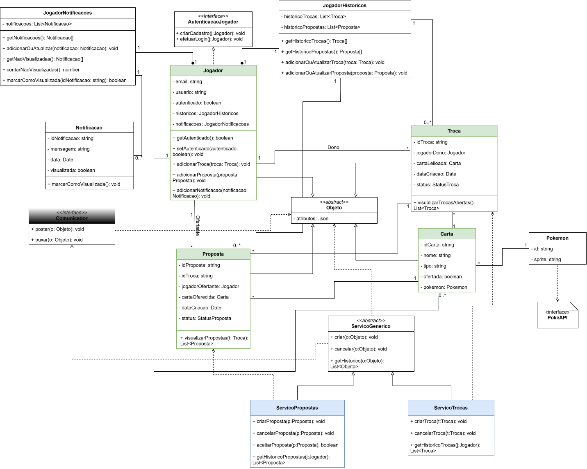

# Visualização de Trocas

## Descrição

A funcionalidade de **Visualização de Trocas** permite que jogadores autenticados consultem as trocas disponíveis e o histórico de trocas realizadas no sistema.

O sistema apresenta informações relacionadas às trocas entre jogadores, incluindo as cartas envolvidas, os jogadores participantes, o status da negociação e a data de criação da troca.

Além da consulta, o sistema permite acompanhar notificações relacionadas às negociações e visualizar detalhes das cartas envolvidas.

## Sumário
1. [Atores](#atores)
2. [Pré-requisitos](#pré-requisitos)
3. [Funcionalidades](#funcionalidades)
    - 3.1 [Consultar disponibilidade de trocas](#consultar-disponibilidade-de-trocas)
    - 3.2 [Ver detalhes de uma carta em troca](#ver-detalhes-de-uma-carta-em-troca)
    - 3.3 [Ver histórico de trocas](#ver-histórico-de-trocas)
    - 3.4 [Notificações](#notificações)
4. [Fluxo principal](#fluxo-principal)
5. [Estrutura das trocas](#estrutura-das-trocas)
6. [Relacionamentos](#relacionamentos)
7. [Resultado esperado](#resultado-esperado)
8. [Documentação](#documentação)
9. [Padrões arquiteturais](#padrões-arquiteturais)
    - 9.1 [MVC e divisão da equipe](#mvc-e-divisão-da-equipe)
    - 9.2 [SPA](#spa)
    - 9.3 [REST](#rest)
    - 9.4 [Mensageria](#mensageria)
    - 9.5 [Padrões descartados](#padrões-arquiteturais-descartados)
10. [Design Patterns](#design-patterns)
    - 10.1 [Criacional: Factory Method](#criacional-factory-method)
    - 10.2 [Estrutural: Facade](#estrutural-facade)
    - 10.3 [Comportamental: Observer](#comportamental-observer)
    - 10.4 [Padrões descartados](#design-patterns-descartados)
11. [Project structure](#project-structure)
12. [Como Rodar](#como-rodar)

## Atores

A funcionalidade possui interação com os seguintes atores e sistemas:

- **Jogador:** usuário responsável por consultar as trocas e seu histórico.
- **Sistema de Jogador:** responsável pelas operações relacionadas ao cadastro e autenticação.
- **Visualização de Cartas:** fornece os detalhes das cartas envolvidas nas trocas.
- **Poke API:** utilizada como apoio para obtenção de informações relacionadas às cartas/Pokémon.
- **Sistema Broker:** responsável pela comunicação e envio de notificações relacionadas às trocas.
- **Sistema de Trocas:** responsável pelo gerenciamento das operações de troca.

## Pré-requisitos

Para utilizar a funcionalidade:

- O jogador deve possuir cadastro no sistema;
- O jogador deve estar autenticado;
- O jogador deve possuir acesso à funcionalidade de trocas;
- Devem existir registros de trocas para que possam ser consultados.

## Funcionalidades

### Consultar disponibilidade de trocas

O jogador pode consultar as trocas disponíveis no sistema.

O sistema verifica a disponibilidade das cartas envolvidas antes de apresentar ou permitir a continuidade de uma negociação.

### Ver detalhes de uma carta em troca

O jogador pode consultar informações sobre uma carta que esteja envolvida em uma troca.

A visualização apresenta os dados da carta, como:

- Identificador da carta;
- Nome;
- Tipo;
- Disponibilidade.

### Ver histórico de trocas

O jogador pode consultar seu histórico de trocas.

O histórico é composto pelos registros de `Troca` associados ao jogador e permite acompanhar negociações anteriores e seus respectivos dados.

Cada troca pode apresentar:

- Identificador da troca;
- Jogador solicitante;
- Jogador destinatário;
- Carta oferecida;
- Carta solicitada;
- Status da troca;
- Data de criação.

### Notificações

O sistema pode notificar o jogador sobre eventos relacionados às trocas.

Entre eles estão:

- Nova troca requisitada;
- Troca disponível;
- Atualizações relacionadas à negociação.

As notificações possuem um identificador, uma mensagem, uma data e a informação de terem sido ou não visualizadas.

## Fluxo Principal

1. O jogador realiza seu cadastro, caso ainda não possua uma conta.
2. O jogador efetua login no sistema.
3. O jogador acessa a funcionalidade de visualização de trocas.
4. O sistema consulta as trocas relacionadas ao jogador.
5. O jogador pode consultar a disponibilidade das trocas.
6. O sistema apresenta os dados das trocas encontradas.
7. O jogador pode visualizar os detalhes das cartas envolvidas.
8. O jogador também pode acessar seu histórico de trocas.
9. Quando necessário, o sistema envia notificações relacionadas às negociações.

## Estrutura das Trocas

Uma troca é representada pela entidade `Troca`, que possui os seguintes dados:

| Atributo | Tipo | Descrição |
|----------|------|-----------|
| `idTroca` | string | Identificador único da troca |
| `jogadorDono` | Jogador | Jogador responsável por criar a troca |
| `cartaLeiloada` | Carta | Carta disponibilizada pelo jogador na troca |
| `dataCriacao` | Date | Data de criação da troca |
| `status` | StatusTroca | Estado da troca: Aberta, Concluida ou Cancelada |
  

## Relacionamentos

O sistema estabelece os seguintes relacionamentos principais:

- Um **Jogador** pode participar de diversas trocas;
- Uma **Troca** possui uma carta oferecida;
- Uma **Troca** possui uma carta solicitada;
- Um **Jogador** possui um histórico de trocas;
- Uma **Troca** pode gerar notificações;
- As **Cartas** possuem um estado de disponibilidade utilizado durante as negociações.

## Resultado Esperado

Ao utilizar a funcionalidade, o jogador consegue visualizar de forma organizada as trocas disponíveis e seu histórico de negociações.

O sistema permite identificar quem participa da troca, quais cartas estão sendo negociadas, o status da operação e quando a troca foi criada, além de fornecer acesso aos detalhes das cartas e às notificações relacionadas ao processo.

## Documentação

- Diagrama de caso de uso:

- Diagrama de classes:

- Documentação do caso de uso:

[Documentação do caso de uso](docs/Documentação_casos_de_uso_.pdf)

## Padrões Arquiteturais

A aplicação da Equipe 5 combina **MVC** (organização interna e divisão de responsabilidades) com **SPA** (modelo de entrega da interface). A comunicação com os demais sistemas é prevista via **REST** e **mensageria** através do Broker.

### MVC e divisão da equipe

O MVC foi escolhido porque o projeto precisa separar o **Modelo** (representações internas, como a lógica de como uma troca funciona) da **Visualização** (a UI entre o usuário e as trocas, responsabilidade principal do nosso grupo), com as ações e a lógica de fluxo ficando em uma camada intermediária. Essa separação facilita a organização, a manutenção e a evolução do projeto, e permite que cada subgrupo trabalhe em paralelo com baixo acoplamento.

| Camada | Responsabilidade | Integrantes | Onde fica no repositório (`app/src/`) |
|---|---|---|---|
| **Model** | Classes e regras de negócio: `Jogador`, `Troca`, `Proposta`, `Carta`, `Pokemon`, `Notificacao` | Giovanna e Maria Luisa | `models/` |
| **View** | Interface em React: páginas e componentes de UI, que apresentam os dados e recebem a interação do usuário | Mayara, Ana e Marcelo | `pages/`, `components/` |
| **Controller** | Trata as ações do usuário e faz a ponte entre View e Model, incluindo a comunicação com os demais sistemas | Rômulo e Marcelo | `services/`, `hooks/` |

Marcelo atua em duas camadas (View e Controller) por ter proposto a interface e coordenado a modelagem, o que ajuda a manter o alinhamento entre elas.

### SPA

O projeto segue o padrão **SPA (Single Page Application)**: o navegador carrega um único `index.html` uma única vez, e a troca entre telas (Trocas, Notificações, Login, Histórico) acontece no cliente, sem recarregar a página. Justificativas:

- **Experiência contínua:** o jogador alterna entre trocas disponíveis, histórico e notificações sem recarregamentos, e a tela se atualiza quando chegam novos eventos do Broker.
- **Encaixe com a divisão de responsabilidades:** como o backend é de responsabilidade de outro grupo, nossa aplicação é apenas o cliente. A SPA consome as APIs REST e as mensagens do Broker, sem precisar renderizar HTML no servidor.
- **Stack adequada:** React + TypeScript com Vite entrega bundle único, HMR em desenvolvimento e componentização, o que combina com a camada View do MVC.
- **Escopo:** o conjunto de telas é pequeno (login/cadastro, trocas abertas com detalhes e propostas, notificações e histórico), e não há necessidade de SEO ou renderização no servidor, que são os principais motivos para evitar uma SPA.

Na combinação com o MVC, a **View** são os componentes React, o **Model** são as classes TypeScript e o **Controller** são os serviços/hooks que a View chama.

### REST

A aplicação prevê REST para a comunicação com os demais sistemas, principalmente para consultar informações de trocas, jogadores e cartas. Os recursos planejados são:

| Recurso | Recebe | Devolve |
|---|---|---|
| Consulta de trocas disponíveis | Identificação do jogador autenticado | Lista de trocas disponíveis, com cartas envolvidas, jogadores participantes e status da negociação |
| Consulta do histórico de trocas | Identificação do jogador | Histórico de negociações, com cartas negociadas, participantes, datas e status |
| Consulta de detalhes da carta | Identificador da carta | Informações da carta: nome, tipo e disponibilidade |
| Decisão sobre uma troca | Identificação da troca e decisão do jogador (aceitar ou recusar) | Confirmação da operação e, quando realizada, o status atualizado da negociação |
| Consulta de notificações | Identificação do jogador | Notificações das negociações, com mensagens, datas e se foram visualizadas |

> Esses recursos estão previstos na estrutura e na documentação do projeto, mas os endpoints REST ainda não foram implementados.

### Mensageria

A aplicação **publica** as ações do usuário (por exemplo, aceitar uma proposta ou criar uma troca) e **assina**, via grupo Broker, as informações vindas dos grupos de Trocas e de Jogador.

### Padrões arquiteturais descartados

| Padrão | Motivo |
|---|---|
| **SOA** | O grupo não lida com serviços em larga escala, e não há necessidade extrema de separação de serviços e contratos. |
| **Broker** (como padrão interno) | O escopo da aplicação não exige um broker próprio nem grande escalabilidade. Usamos o Broker do sistema apenas como consumidor/publicador. |
| **MVVM** | É mais usado em aplicações client-side com binding bidirecional; o MVC atende melhor a divisão da equipe em Model, View e Controller. Poderia ser reconsiderado se a arquitetura geral do projeto fosse diferente. |

## Design Patterns

Os exemplos abaixo usam como base o [diagrama de classes](docs/Diagrama_de_Classe_VdT.drawio.svg) do projeto.

### Criacional: Factory Method

**Escolha:** o sistema precisa criar diferentes tipos de elementos (trocas, propostas, notificações), cada um com regras próprias, mas tratados de forma uniforme pelo restante da aplicação. O Factory Method define uma estrutura geral de criação e delega às especializações a decisão de qual objeto concreto instanciar. Quem o utiliza conhece apenas o contrato comum, o que reduz o acoplamento, torna o código mais previsível e favorece a extensibilidade (novo tipo = nova especialização, sem alterar o existente, em conformidade com o princípio Open/Closed). A lógica de criação fica concentrada em um único ponto, e não espalhada pelo código.

**No diagrama de classes:**

| Papel no padrão | Classe do diagrama |
|---|---|
| Produto (contrato comum) | `Objeto` (abstrata), com `Jogador`, `Troca`, `Proposta`, `Carta` e `Notificacao` como produtos concretos |
| Criador (estrutura geral de criação) | `ServicoGenerico` (abstrata), com `criar(o: Objeto)`, `cancelar(o: Objeto)` e `getHistorico(o: Objeto)` |
| Criadores concretos | `ServicoTrocas` (`criarTroca(t: Troca)`) e `ServicoPropostas` (`criarProposta(p: Proposta)`) |

Quem consome o serviço depende apenas de `ServicoGenerico` e de `Objeto`. Para adicionar um novo tipo (por exemplo, um serviço de notificações), basta criar uma nova especialização de `ServicoGenerico`, sem alterar `ServicoTrocas` nem `ServicoPropostas`.

### Estrutural: Facade

**Escolha:** simplificar o acesso aos serviços de trocas, propostas, jogadores e cartas. Uma fachada reúne as consultas necessárias para carregar as telas, evitando que os componentes da interface precisem coordenar cada serviço separadamente. Isso reduz o acoplamento e facilita manutenção e testes.

**No diagrama de classes:** carregar a tela "Trocas disponíveis" exige dados de `ServicoTrocas` (`getHistoricoTrocas(j: Jogador)`), de `ServicoPropostas` (`getHistoricoPropostas(j: Jogador)`), de `Jogador` (`JogadorNotificacoes`, `JogadorHistoricos`) e de `Carta`/`Pokemon` (nome, tipo, sprite via PokeAPI). A fachada expõe uma única chamada para a View e esconde essas quatro origens; a View não precisa conhecer `ServicoTrocas`, `ServicoPropostas` nem a PokeAPI.

### Comportamental: Observer

**Escolha:** atualizar diferentes partes da interface quando o Broker gerar eventos. Listas de trocas e notificações reagem automaticamente às mudanças, sem depender diretamente umas das outras, e novos observadores podem ser adicionados sem alterar a estrutura existente. Enquanto o Factory Method cria os objetos e a Facade simplifica as consultas, o Observer coordena as atualizações da interface.

**No diagrama de classes:**

| Papel no padrão | Classe do diagrama |
|---|---|
| Fonte dos eventos (subject) | `Comunicador` (interface com `postar(o: Objeto)` e `puxar(o: Objeto)`), ligada ao Broker |
| Evento / dado propagado | `Troca`, `Proposta` e `Notificacao` (todas `Objeto`) |
| Observadores | Lista de trocas, lista de notificações e histórico (`JogadorNotificacoes`, `JogadorHistoricos`) |

Exemplo: quando o Broker informa que uma proposta foi aceita, `Comunicador` publica o evento, e a lista de trocas e a de notificações se atualizam sozinhas, sem se conhecerem.

### Design Patterns descartados

**Criacionais**

| Padrão | Motivo |
|---|---|
| Abstract Factory | Não há famílias de objetos relacionados que precisem ser criados em conjunto. |
| Builder | Os objetos do sistema têm poucos atributos e construção simples (ex.: `Carta` com 5 atributos). |
| Prototype | Não há necessidade de clonar objetos custosos; a criação parte dos dados fornecidos pelo backend. |
| Singleton | O ganho de uma instância única é pequeno, o padrão dificulta testes e aumenta o acoplamento, e o TypeScript já oferece módulos de instância única. |

**Estruturais**

| Padrão | Motivo |
|---|---|
| Adapter | Ainda não há incompatibilidade entre contratos externos e interfaces da aplicação. Pode ser reconsiderado na integração. |
| Bridge | Não há duas dimensões de implementação que variem de forma independente. |
| Composite | Trocas, propostas e cartas não formam hierarquia em árvore. |
| Decorator | Não é preciso adicionar comportamentos por camadas de envolvimento. |
| Flyweight | Não há volume de objetos semelhantes que justifique compartilhar estado. |
| Proxy | Não é preciso objeto substituto para controlar acesso, carregamento tardio ou cache; as chamadas às APIs são feitas pelos serviços. |

**Comportamentais**

| Padrão | Motivo |
|---|---|
| Chain of Responsibility | As ações de troca são tratadas diretamente pelos serviços específicos, sem cadeia de responsáveis. |
| Command | As operações de troca e proposta podem ser executadas diretamente pelos serviços. |
| Iterator | Os recursos nativos do TypeScript atendem à necessidade de percorrer coleções. |
| Mediator | A comunicação entre componentes já é organizada pelos serviços e pelo Broker. |
| Memento | O histórico de trocas é tratado pelos serviços, sem necessidade de restaurar estados anteriores. |
| State | Os estados de `Troca` e `Proposta` (Aberta, Cancelada, Aceita, Recusada) são controlados por atributo e regras simples. |
| Strategy | Não há algoritmos intercambiáveis em tempo de execução; as regras de negociação seguem um fluxo definido. |
| Template Method | Não há processos com sequência fixa de etapas que precisem de implementações diferentes por herança. |
| Visitor | Não é preciso adicionar operações a estruturas de objetos sem modificar suas classes. |

## Project structure

`docs/`: Diagramas UML e documentação de casos de uso

`app/`: aplicação web (React + TypeScript, feito usando Vite)

| Path | Purpose |
|---|---|
| `index.html` | Página HTML que o app React carrega|
| `public/` | Arquivos estáticos (não-importados) |
| `src/main.tsx` | Onde o app começa; renderiza `App` em `index.html` |
| `src/App.tsx` | Componente root; faz o setup das páginas |
| `src/index.css` | Estilos .css globais |
| `src/models/` | Tipos TypeScript para cada classe no UML, um arquivo por classe: Jogador, Troca, Carta, Notificacao |
| `src/services/` | Lógica das fucionalidades (criarTroca, consultarDisponibilidade... -> trocaService.ts, criarCadastro, efetuarLogin... -> jogadorService.ts...), um arquivo classeService.ts por classe |
| `src/pages/` | Páginas (login, trocas, histórico, etc.) |
| `src/components/` | UI reutilizável (card, notificação...), um arquivo de componente PascalCase.tsx, exemplos: CartaCard.tsx (com nome, tipo, se está disponível...), NotificaçãoItem.tsx (uma notificação genérica)...; Páginas são compostas por componentes, e componentes não possuem lógica, são apenas UI |
| `src/hooks/` | Lógica React compartilhada |
| `src/assets/` | Imagens e ícones importados pelo código |
| `package.json` | Dependências e scripts (`npm run dev`, `npm run build`) |
| `tsconfig*.json` | Configurações do TypeScript |
| `vite.config.ts` | Configurações do Vite (dev server/build) |
| `.oxlintrc.json` | Configurações do Linter (code checker) |

## Como rodar

    cd app
    npm install
    npm run dev

Abrir http://localhost:5173 no browser de escolha
